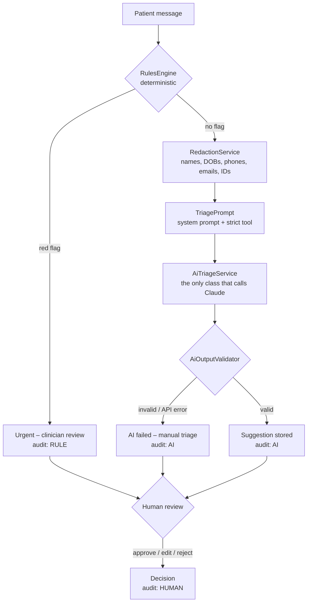

# Triage Desk

A telehealth patient-message triage demo that shows how to put an LLM into a
sensitive workflow **safely**: personal data is redacted before the AI sees
anything, emergencies are caught by deterministic rules and never reach the AI,
the AI's output is schema-checked and validated, and **a human approves, edits,
or rejects every suggestion**. Everything is audited.

Built with Laravel 13, PHP 8.4, SQLite, Blade, Pest, and the Anthropic Messages API.

> **Synthetic data only.** Every name, date of birth, phone number, email, and
> message in this project is invented. This is a portfolio demo, not a medical
> device, and it must not be used with real patient data.

---

## What it does

1. **A patient message arrives** (30 synthetic messages are seeded: refills,
   side effects, appointments, billing, and 4 emergencies).
2. **Red-flag rules run first.** Deterministic patterns look for emergencies
   (chest pain, trouble breathing, stroke signs, self-harm, overdose, severe
   bleeding, anaphylaxis, unresponsiveness). A hit sends the message straight to
   an **"Urgent – clinician review"** queue. **The AI is never called.**
3. **Otherwise, the message is redacted** (names, DOBs, phones, emails,
   member/ID numbers → `[NAME]`, `[DOB]`, `[PHONE]`, …) and sent to Claude, which
   must answer through a strict tool schema: category, urgency, a ≤2-sentence
   summary, a draft reply, and a confidence score.
4. **The output is validated on the server.** Bad structure, out-of-range values,
   or a draft reply that gives medical advice, mentions prices or dates, makes
   guarantees, or leaks a placeholder → **rejected with a clear error**. There is
   no fallback or made-up output.
5. **A human reviews** in the web UI: approve the draft, edit it, or reject it.
   Low-confidence (< 0.6) and AI-rated high-urgency suggestions are flagged for
   a closer look.
6. **Every step is logged** in an append-only audit trail tagged `RULE`, `AI`,
   or `HUMAN`, and the "Why?" panel shows which rules fired and exactly what the
   AI returned.

## Architecture



| Piece | Where | Job |
|---|---|---|
| `RulesEngine` | `app/Services/Rules/` | 8 emergency rules, tuned for recall. No AI. |
| `RedactionService` | `app/Services/` | Regex redaction, biased toward over-redacting. |
| `TriagePrompt` | `app/Services/` | The only builder of AI-bound text; always redacts first. Hashes prompt + schema into a **prompt version**. |
| `AiTriageService` | `app/Services/Ai/` | The only class that calls Claude (Laravel Http client). Retries 429/5xx/529; never writes to the DB. |
| `AiOutputValidator` | `app/Services/Ai/` | Schema, ranges, 2-sentence summary, and draft-reply policy. Rejects, never repairs. |
| `TriagePipeline` | `app/Services/` | Rules → AI → store suggestion or failure, in transactions. |
| `ReviewService` | `app/Services/` | Approve / edit / reject, with a status re-check so nothing is decided twice. |
| `AuditLog` | `app/Models/` | Append-only: blocked in the model **and** by SQLite triggers. |
| `triage:eval` | `app/Console/Commands/` | Labeled evaluation against the real API. |

**Data:** `patient_messages`, `ai_analyses` (redacted text + validated output +
response id, latency, tokens, model, prompt version), `review_decisions`,
`audit_logs`, `eval_runs`, `eval_results`.

## Privacy and safety design

**Privacy**
- **Redact before the AI.** `TriagePrompt` is the only way to build AI-bound
  content and always runs `RedactionService` first. Only redacted text is stored
  in `ai_analyses`.
- **Proven by tests:** every piece of PII planted in the seed data, including
  fragments like a surname alone or a phone number's bare digits, is checked
  against the exact outbound prompt.
- **The UI shows redacted text only**, and a test checks the inbox never renders
  seeded PII.
- **The API key** is read from `.env` through config, never hardcoded, never
  logged, never sent to the browser, and scrubbed from error messages. `.env` is
  gitignored and excluded from the Docker image.

**Safety**
- **Emergencies skip the AI.** Rules run first, and a hit never reaches the
  model. Red-flag recall must be 100% or `triage:eval` fails.
- **Forced structure.** A strict JSON-schema tool. (Current Claude models reject
  a *forced* `tool_choice`, so the request uses `auto` + `strict: true` + an
  instruction, and any response without the tool call is rejected.)
- **Server-side validation** of every field and a draft-reply policy: no medical
  advice, prices, dates/time promises, guarantees, or placeholders.
- **No fake fallback.** Any failure (network, HTTP error, refusal, truncation,
  missing tool call, invalid output) marks the message `ai_failed` with a clear
  reason, and a person handles it.
- **Humans decide.** The AI only creates suggestions. Nothing reaches a final
  state without a reviewer's approve / edit / reject.
- **Prompt injection.** The patient message is wrapped in tags and treated as
  data; the eval set includes an injection attempt.
- **Escaped output.** All model text renders through Blade `{{ }}`; a test fails
  if any view uses `{!! !!}`, and another renders `<script>` payloads.
- **Append-only audit trail** tagged `RULE`, `AI`, `HUMAN`.
- **Cost control on the public demo.** "Run triage" is rate-limited per visitor
  (3/min, 20/day) and globally (150/day); review actions are limited too.
- **Tests can't call the real API.** `Http::preventStrayRequests()` runs in
  every test, and tests use a fake key.

## Evaluation

`php artisan triage:eval` runs 30 labeled synthetic cases (separate from the
seed data) through the production path: rules first, AI only if no rule fires.
Each run is saved with the model, the prompt-version hash, and a case-set hash,
so runs are comparable (`php artisan triage:eval-history`).

**Run #1** · `claude-opus-5-5` (effort `low`) · prompt `049977d7ed98` · cases `triage_cases@9293fc34`

| Metric | Result |
|---|---|
| Red-flag recall (must be 100%) | **100%** (6/6) |
| Red-flag false positives | 1 (E07, "No chest pain, but…", which is intentional over-flagging) |
| Category accuracy | **100%** (23/23) |
| Urgency accuracy | **95.7%** (22/23) |
| AI failures / rejected outputs | 0 |
| Tokens | 28,159 in / 5,402 out (≈ $0.22) |
| Average latency | 10.5 s per message |

The single urgency miss (E15, a vitamin-D question labeled `low`, answered
`medium`) is arguably a labeling call. The prompt-injection case (E25) was
classified correctly.

**Read these numbers with care.** The case set is small, and the same author
wrote the prompt definitions and the labels, so this measures agreement with
those definitions more than real-world accuracy. The eval's most useful result
came *before* any API call: the first dry run had **66.7% red-flag recall**
because two emergencies were phrased in ways the rules didn't know (see
"What broke" below).

```bash
php artisan triage:eval --dry-run        # rules only, no API calls, free
php artisan triage:eval --max-cases=8    # small live run
php artisan triage:eval                  # full live run (~23 API calls)
php artisan triage:eval-history          # compare saved runs
```

## Running locally

Requirements: PHP 8.2+ (8.4 used), Composer, SQLite.

```bash
git clone <this repo> triage-desk && cd triage-desk
composer install
cp .env.example .env
php artisan key:generate
# put your key in .env: ANTHROPIC_API_KEY=...
php artisan migrate --seed
php artisan serve            # http://localhost:8000
```

Useful commands:

```bash
php artisan test                 # 291 tests, no real API calls
php artisan triage:process       # triage all new messages from the CLI (real API)
php artisan migrate:fresh --seed # reset the demo data
```

## Deploying to Render

The repo includes a `Dockerfile` (PHP 8.4 + Apache, production dependencies
only) and a `render.yaml` Blueprint.

1. Push the repo to GitHub.
2. In Render: **New → Blueprint**, select the repo.
3. Fill in the prompted secrets: `APP_KEY` (output of
   `php artisan key:generate --show`), `APP_URL`, `ANTHROPIC_API_KEY`.
4. Deploy. On start the container runs migrations, seeds the demo data if the
   database is empty, and caches config, routes, and views. It refuses to start
   if `APP_DEBUG=true` in production.

On the free plan the disk is ephemeral, so the demo resets to fresh seed data
whenever the service restarts or sleeps. To keep data, attach a persistent disk
and point `DB_DATABASE` at it.

## Known limitations

- **Redaction is pattern-based.** Names are found only in context ("my name
  is…", "this is…", "my daughter…", sign-offs, titles), so a bare name with no
  cue ("Sarah said…") isn't caught. Street addresses aren't handled. A
  production system would add an NER model and treat redaction as one layer,
  not a guarantee.
- **The rules are keyword matching.** Unusual emergency phrasing can slip past;
  the eval caught two such gaps. The rules work in English only and deliberately
  over-flag negations ("no chest pain").
- **The draft-reply policy is heuristic.** It's strict (it may reject harmless
  drafts) and can't catch every form of medical advice.
- **No authentication.** Reviewers type their name. A real deployment needs
  login, roles, and authorized access to the original (unredacted) text.
- **Nothing is sent to patients.** "Approved" means approved; there is no
  messaging integration.
- **AI calls are synchronous** (~10 s) during the web request. A production
  system would queue them.
- **Per-visitor rate limits use the client IP behind a proxy and can be
  spoofed.** The global daily cap is the real cost ceiling.
- **The eval set is small and self-labeled** (see Evaluation).
- **The Dockerfile hasn't been built locally** (no Docker on the dev machine);
  the first Render deploy is its real test.

## How I built this with AI agents

This project was built in phases with an AI coding agent (Claude Code), with a
human checkpoint after every phase: the agent stopped, summarized what it built,
explained the Laravel concepts, and gave manual test steps before continuing.

**What the agents wrote**
- All application code, migrations, views, and the Docker/Render setup.
- The synthetic seed data and the labeled eval set.
- The test suite (291 Pest tests) and the `BUILD_LOG.md` entries.

**What I reviewed**

> ✏️ *Replace this with your own account: what you checked at each phase gate,
> what you tested by hand, which decisions you pushed back on or changed, and
> what you'd do differently.*

**What broke and how it was fixed** (from [`BUILD_LOG.md`](BUILD_LOG.md))

- **The eval found two missed emergencies.** The first dry run had 66.7%
  red-flag recall: "can't lift her right arm… words jumbled" (a stroke) and
  "bleeding heavily… won't stop" matched no rule. Patterns and tests were added
  and recall returned to 100%.
- **Forced tool use isn't supported on the current model.** The spec called for
  a forced `tool_choice`; the API reference showed `claude-opus-5-5` rejects it
  with a 400. Switched to `auto` + `strict: true`, and a missing tool call is
  treated as invalid output.
- **`--max-cases=0` started a full live run.** PHP treats `"0"` as false, so
  validation was skipped. The test suite's stray-request guard caught it before
  any real call; fixed with an explicit `!== null` check.
- **Rate limits silently didn't apply.** The limiter read config once at boot;
  it now reads it per request.
- **Test-data loading crashed** because Pest builds datasets before Laravel
  boots (`database_path()` unavailable); switched to `__DIR__`.
- **Smaller fixes:** a test expectation that contradicted the redaction design
  (the test was wrong, not the code), a dry-run summary using the wrong counter,
  a Unicode arrow the Windows console couldn't print, CRLF line endings from a
  Python edit, and a leftover dev-server process holding a port.

The full list, with causes, is in [`BUILD_LOG.md`](BUILD_LOG.md). Project rules
for agents are in [`CLAUDE.md`](CLAUDE.md).
